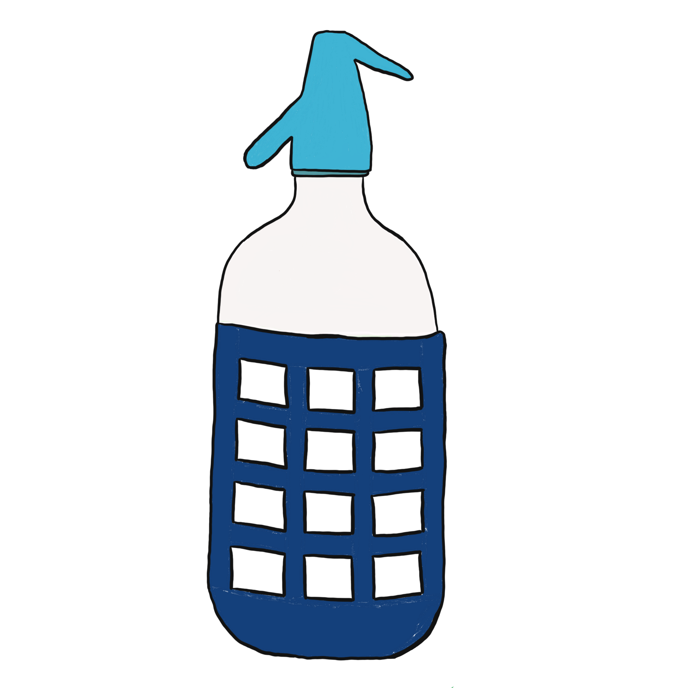

<p align="center">  
	  
</p>
# sfdl

Boosts productivity during debugging process Apex log analysis

## Install as a unpacked extension?

- Clone this repository
- From terminal navigate to the folder you clone the respository and rung:
	- npm install
	- npx webpack
		- This command will create a folder called 'dist' that we will in the last step
- Install chrome https://www.google.com/chrome
- Go to chrome://extensions
- Activate Developer mode
- Click on Load unpackaged button
- Navigate to the repository cloned and select the folder dist

## Downloading logs

Pick the org at the top of the log list of the Debug Logs tab, next to the buttons that
query its logs again and filter that query, a click anywhere else closing the filter.
The list folds into a strip reading Log List. It then offers three ways of getting logs
out of the org:

- **One log at a time**: every row in the log list has a download icon on its right. It
  saves that single log as a plain `.log` file, no zip involved.
- **A selection of logs**: every row also has a checkbox. Tick the logs you care about
  and the button turns into `Download selected logs (n)`; the checkbox above the button
  ticks and unticks the whole list at once.
- **Every log**: with nothing ticked the button reads `Download all logs` and produces
  `sfdl-ApexLog.zip`, exactly as before.

Whatever you download always has the filter pills that are on applied to it, so
the file you get on disk matches what you see in the console.

## Loading

While something loads, a stencil drawn in its shape stands in its place rather than a
spinner: the rows of a log list, the components of a type, the lines of a log or the two
panes of a diff. `sfdl-loading-stencil` holds one template per shape, picked by its
`type`, each one copying the measures of what it stands for.

## Comparing logs

Comparing logs lives in the **Debug Logs** tab, next to reading them. The toggle at the
top of the tab switches between **Analyse** and **Compare logs**, and Compare logs
between **Same org** and **Two orgs**. Each keeps what it had on screen while another
one is open. Whatever comes only from the left log shows in light blue, whatever comes
only from the right log in light amber.

- **Same org**: one list of the logs of an org, the org of the log list to start with.
  Tick two logs to compare them, the first on the left. A new tick replaces the log
  ticked last, so the other one stays to compare against; a ticked log ticked again
  comes off. The arrow keys walk the list the same way, past the log compared against.
  In Analyse, ticking two logs and clicking `compare side by side` opens them here, the
  older one on the left, the way an editor opens the diff of two files in a view of its
  own, and Analyse keeps the log it shows.
- **Two orgs**: four columns, the logs of the left org, the left log, the right log and
  the logs of the right org. Each side picks its own org at the top of its column, the
  border of the picker in the colour of its side and its name on hover. The left one
  starts on the org of the log list, and an org picked on one side is not offered on
  the other. Click a log to compare it on its side, or walk a list with the arrow keys
  to compare each log against the other side as you go. Both lists filter by any word
  of the log name and fold away.

A new log on one side only reloads that side, the other one stays on screen. Each org
picker still to fill carries the number of its step on its corner, in the alert red of
slds, the next one pulsing, and so does the metadata picker of Compare Metadata. A long
list rises a `Back to the top` at the foot of its panel once scrolled half a panel down.

The filters of a log are pills, outlined in blue on a light blue fill while on, each
explained on hover. Analyse shows
them next to the name of the log:

- **Indent calls** indents each line by how deep it runs, method, constructor, flow and
  code unit entries stepping in and their exits stepping back out.
- **Hide heap and statements** hides the `HEAP_ALLOCATE` and `STATEMENT_EXECUTE` lines.
- **Hide flow noise** hides the flow lines about creating and finishing interviews and
  their limit usage, the flow elements themselves stay.

A comparison shows them in a row above the diff, with three more that only make sense
between two logs, so two runs of the same transaction do not differ on every line:

- **Ignore times** drops the time and nanoseconds that open each line.
- **Ignore record Ids** turns ids into their key prefix followed by `<id>`, so
  `001xx000003DGbYAAW` reads `001<id>`, and `0x7d7d4e32` into `0x<address>`.
- **Ignore line numbers**, off by default, for logs of code that moved.

The bar above the diff counts the differences, walks them with the chevrons and switches
to a single column or to ignoring whitespace.

A log body is downloaded once and kept while the console is open.

## Comparing metadata

The **Compare Metadata** tab compares the metadata of two orgs. Pick the left org on the
left and the right org on the right, an org picked on one side is not offered on the
other, then pick what to compare at the top of the Components column:

| Group | Types |
| --- | --- |
| Code | Apex Classes, Apex Triggers, Visualforce Pages, Visualforce Components |
| User interface | Lightning Web Components, Aura Components, Lightning Pages, Page Layouts, Static Resources |
| Data model | Custom Objects, Standard Objects, Custom Settings, Custom Metadata Records, Global Value Sets |
| Automation | Flows, Workflow Rules |
| Configuration | Custom Labels, Custom Permissions, Remote Site Settings, Named Credentials |

Nothing is retrieved until you ask for it, so a big org is never retrieved whole:

1. Picking a type lists the names both orgs hold, one call per org (`listMetadata`, or
   `describeGlobal` for custom settings). Every component reads **In both**, **Only
   left** or **Only right**, and its tooltip says when and by whom each org last
   changed it. Components of managed packages are left out.
2. Clicking a component retrieves that one component from both orgs, or from the one
   org that holds it, and opens its first difference.
3. A compared component reads **Different** or **Identical** and lists its files.
   Objects are split the way sfdx splits them, so `Account` lists
   `fields/Tier__c.field` and each validation rule, record type and list view on its
   own. Workflows split into their rules and actions, and every custom label is its own
   component.

When everything compared is identical the panel says so on top and still lists the
files. There is no refresh to remember: picking a type lists both orgs again, and a
component retrieved before is reused only while the org still gives it the same last
modified date, so anything changed since is retrieved again. The status of a retrieve
is checked less and less often, from every two seconds up to every ten, since every
check is an api request of the org.

Custom settings are read through REST rather than the Metadata API, since their values
are data: each one is written out with its fields and every value, the org default,
then the profiles and the users by name, so a different endpoint or switch shows up as
a line of the diff. Their values change without a trace in the listing, so they are
read again every time they are compared.

Profiles and permission sets are left out on purpose: retrieved on their own they only
carry the permissions of the other components of the same retrieve, so comparing them
would report differences that are not there.

## Run the unit tests

```bash
npm install
npm run test:unit             # run every suite once
npm run test:unit:watch       # re-run the suites while you edit
npm run test:unit:coverage    # same, with a coverage report in ./coverage
```

The suites live next to the code they cover, in `__tests__` folders. `jest/setup.js`
provides the `chrome.*` extension APIs and the constructable stylesheet polyfill that
every suite needs, and `jest/lwcCoverageTransformer.js` adds the istanbul instrumentation
the LWC jest transformer does not ship with.

## Test the extension before publishing

1. Build a fresh `dist` folder:
   ```bash
   npm install
   npm run test:unit
   npx webpack
   ```
2. Load it in Chrome:
   - go to `chrome://extensions`
   - turn **Developer mode** on
   - click **Load unpacked** and select the `dist` folder
   - if the extension was already loaded, hit the **reload** icon on its card so Chrome
     picks up the new build
3. Log in to the Salesforce org you want to analyse in the same browser profile, then
   click the sfdl icon and **Launch sfdl Console Station**.
4. Walk through the checklist:
   - the org shows up in the picker at the top of the log list and the list fills in
   - clicking a log renders it in the editor with the log name in the header
   - the download icon on a single row saves one `.log` file
   - ticking rows turns the button into `Download selected logs (n)` and saves only
     what is ticked; the checkbox above the button ticks and unticks the whole list
   - `Download all logs` still produces `sfdl-ApexLog.zip`
   - the progress bar and its cancel button behave during a long download
   - Debug Logs, Analyse: ticking two logs offers `compare side by side`, which opens
     them in Compare logs, Same org, and Analyse still shows its log when you go back
   - Debug Logs, Compare logs, Same org: a third tick replaces the last one, the first
     stays on the left and only the right side reloads
   - Debug Logs, Compare logs, Two orgs: each side lists the logs of its own org, the org of
     one side is not offered on the other, the timestamp and id filters make two runs
     of the same transaction differ only where they really do
   - Compare Metadata: picking a type only lists names, opening a component compares
     it
   - Compare Metadata with Custom Objects: a changed field shows as its own file
5. Keep the service worker console open (`chrome://extensions` → **service worker**) and
   the console page devtools open while you do it: both should stay free of errors.

Downloads land wherever Chrome is configured to put them; check
`chrome://settings/downloads` if you cannot find the files.

## 
